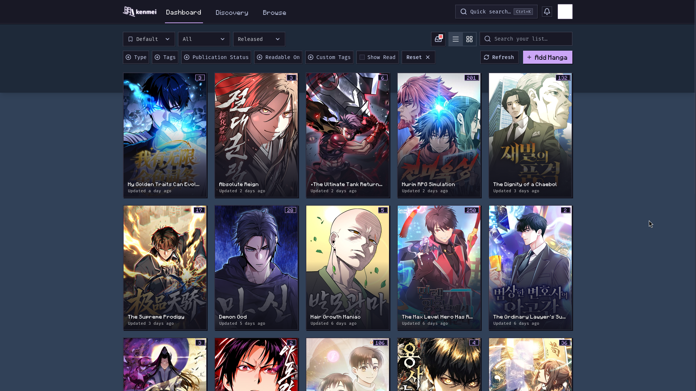
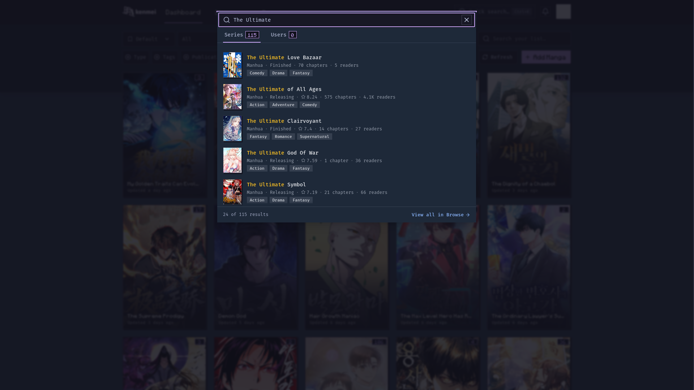
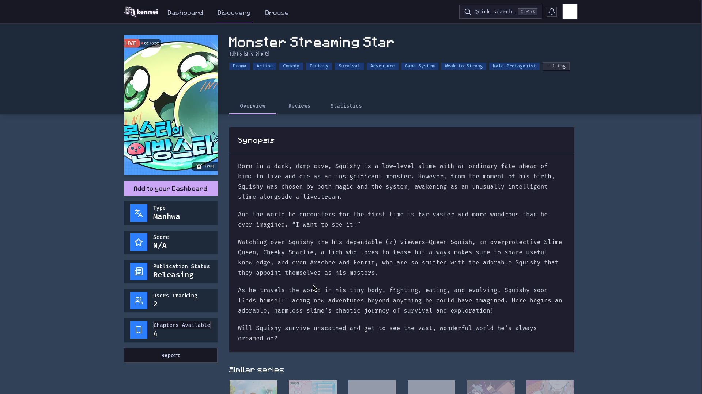
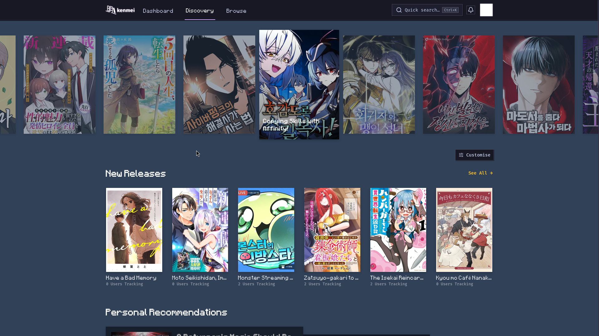
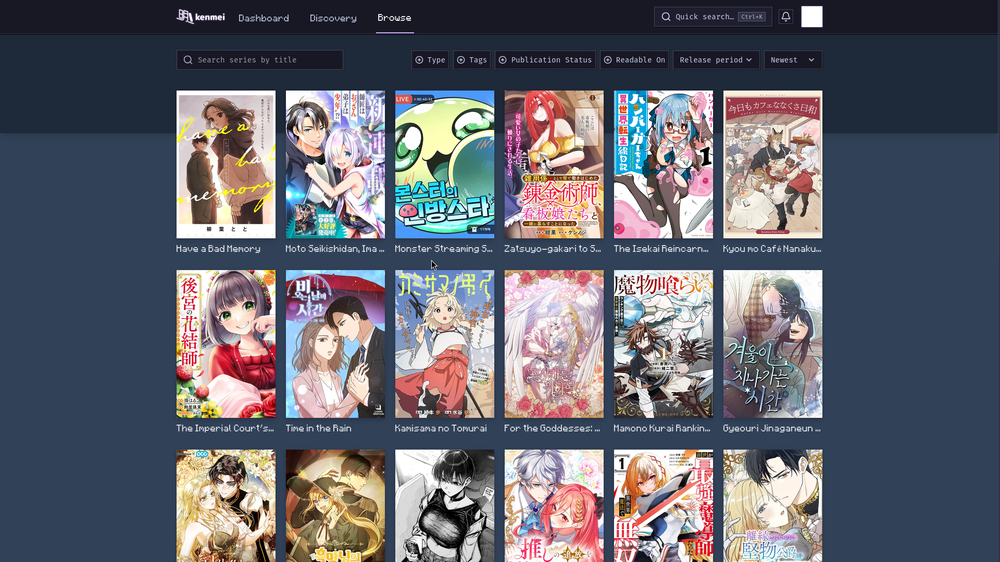

<div align="center">

# Kenmei - Catppuccin Mocha Pixel HUD

<p>
  <strong>Soothing Catppuccin Mocha theme with retro stepped pixel geometry for Kenmei.</strong>
</p>

<p>
  <a href="https://github.com/ractopen/kenmei-catppuccin-mocha/releases"></a>
  <a href="LICENSE"></a>
  <a href="https://raw.githubusercontent.com/ractopen/kenmei-catppuccin-mocha/main/kenmei-catppuccin-mocha.user.js"></a>
  <a href="https://github.com/catppuccin/catppuccin"></a>
</p>

<br>



</div>

<br>

## Preview Gallery

<details open>
<summary><strong>Interface Showcase</strong></summary>
<br>

| Quick Search (`Ctrl+K`) | Series Overview |
| :---: | :---: |
|  |  |

| Discovery View | Browse Catalog |
| :---: | :---: |
|  |  |

</details>

<br>

## Features

- **Cohesive Palette**: Authentic Catppuccin Mocha base tones (`#1e1e2e`, `#181825`, `#11111b`) and vibrant accents (`#cba6f7`, `#a6e3a1`, `#fab387`).
- **Zero-Radius Geometry**: Completely flat, sharp edges across cards, badges, buttons, popovers, and dialogs.
- **Stepped Pixel Shadows**: Retro pixel box-shadows designed to complement pixel/HUD desktop environments.
- **Monospace Typography**: Built with `Minecraft` for headings and counters, with `Fira Code` for body copy and metadata.
- **Instant Dark Enforcement**: Runs at `document-start` with persistent `.dark` observer to eliminate light-mode flashing.

---

## Installation

### Violentmonkey / Tampermonkey

1. Ensure [Violentmonkey](https://violentmonkey.github.io/) or [Tampermonkey](https://www.tampermonkey.net/) is installed in your browser.
2. Click here to install: **[kenmei-catppuccin-mocha.user.js](https://raw.githubusercontent.com/ractopen/kenmei-catppuccin-mocha/main/kenmei-catppuccin-mocha.user.js)**.
3. Confirm the installation in your userscript manager.
4. Navigate to [kenmei.co/dashboard](https://www.kenmei.co/dashboard).

---

## Development

The project is split into modular components under `src/`:

```bash
# Clone the repository
git clone https://github.com/ractopen/kenmei-catppuccin-mocha.git
cd kenmei-catppuccin-mocha

# Rebuild the production userscript
npm run build
```

---

## Documentation

Detailed installation options, tokens reference, and customization guides are available in the **[Documentation](docs/README.md)**.

---

## License

This project is licensed under the [MIT License](LICENSE).
